## Day 1, August 21

### Keynote: Vulnerability Disclosure in the Age of AI · James Forshaw

Rating: ★★★★☆

Forshaw starts all the way back at the 1784 Bramah lock and walks forward through Bugtraq, the early bounty days, iDefense, Pwn2Own, and Project Zero's 90-plus-30 policy. The question hiding under the history walk: which of these assumptions still stand once an LLM can find bugs for pocket change? His answer, basically, is not many. Knowledge used to be the scarce part of disclosure. It isn't anymore.

Two numbers from this talk got repeated in the hallway for the rest of the day: Chrome shipped 370 security fixes in a single July release, and Microsoft's July 2026 Patch Tuesday came in at 622 CVEs. I liked the tier model too: bugs a cheap model finds, bugs only an expensive model finds, bugs no current model finds. It's a decent lens because it tells you who will be filing reports next year, and in what volume.

His proposals: cut the 90-day clock, drop the 30-day patch soak, move the saved effort into fix verification, and find a way to reward reports a human actually sat down and wrote. I'm not fully sold on dropping the soak, but the direction feels right.

His clock argument in picture form:

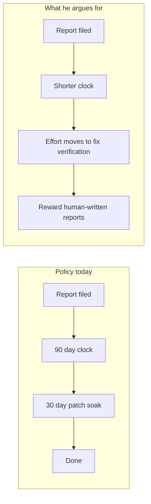

### Agent2Shell: Pre-Prompt RCEs in Claude Code, Cursor, and Gemini · Satoki Tsuji

Rating: ★★★★★

The idea is one of those that sounds obvious the second somebody says it out loud. Everyone is busy hardening the model: prompt injection defenses, guardrails, output filters, alignment. Meanwhile the RCE chains in today's coding agents fire before the model sees anything at all. The tooling parses and executes config first, so opening a folder is enough. His phrasing: opening ≈ executing.

The transcript caught him going target by target, and it's a lineup. Codex runs git unsandboxed because git reads core.sshCommand straight out of .git/config, trust and sandbox bypassed. Cursor ships with workspace trust effectively off, so git command execution just goes through. Claude Code executes mcp.json after one click and one prompt, and the CLI in non-tty mode skips the trust prompt entirely. Gemini runs its own hooks by default. Plus a bonus 0-day on top: a 0-click RCE in the Codex desktop app via .git.

The money part was fun too. On paper the chain was worth around $110,000. They collected about $50,000 for one of them, and a single agent target carried $70,000 by itself. In the Q&A he said the chains took a few weeks to find. A few weeks, for that much exposure. That's the part that should worry the vendors.

Two takeaways stuck: "spec ≠ safe", meaning working as intended can still violate what the user expects, and don't open what you don't trust. The UnPwn2Own framing, they didn't clear the Pwn2Own lottery so they just released everything, is a nice touch. This was the talk I actually did something about: I went home and checked what my own tooling executes on open.

The whole thing in one picture. Every defense on the right lives inside the model, and the attack never bothers to show up there:

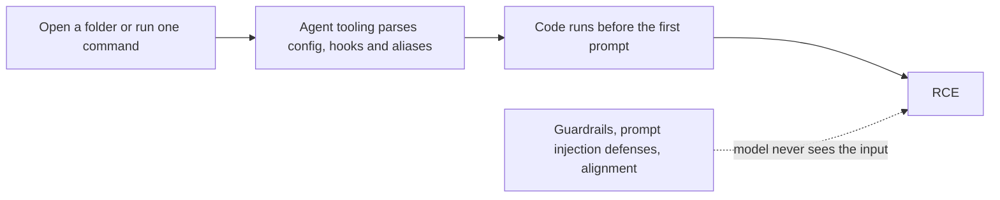

### Endpoint Audit Agent: Scaling AppSec with AI at Dropbox · Po-Ning Tseng

Rating: ★★★★☆

A production story rather than a research pitch, and I mean that as a compliment. The speaker works on Dropbox's product security team, and the setup is a squeeze anyone in AppSec already knows: AI-written code flooding reviews, bounty submissions piling up, five straight weeks of IDOR and access control reports bad enough to trigger SEVs, and the same bug arriving from three researchers in the same window. Triage eats the calendar.

Their answer, after SAST, secure frameworks, and off-the-shelf DAST all came up short (SAST can't see a missing authorization check, generic DAST doesn't know their access model): an agent that reviews every externally facing endpoint using source code plus domain context. Two details survived my rough transcript. SAST flags patterns for humans to triage instead of finding bugs directly, because direct bug finding drowns in false positives. And the agent does judgment work, like comparing permission setups across files, and never performs high-risk operations.

How a finding actually moves through their setup:

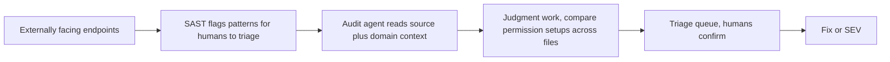

He stated two opinions plainly: don't build a bespoke harness too early, a good model is most of the harness. And don't let the agent write its own skills, you lose the customization and end up with something generic.

The economics, "paid for itself many times over compared to bug bounty spend", were asserted more than shown, and I'd have loved one slide of real numbers there. Still, if you run an AppSec team, this was the most immediately practical talk of Day 1.

### Vulnerabilities Assembled! The Vulnerability Factory Inside the Windows Kernel · Angelboy

Rating: ★★★★★

I gave up my seat on the main track for this one. Zero regrets. Angelboy tells the AFD story as personal history: an IOCTL-driven arbitrary write in a new socket feature that he shrugged off at first ("what era is this, how does this still exist... it was probably just badly written code"), then Celeris publishing AFD research in late 2023, then Lazarus Group abusing AFD bugs in the wild from August 2024, then the same style of page bypass surviving three consecutive patches (per the transcript: InnoWire, then Accept, then SuperAccept, each one reintroducing the same missing check). Somewhere in there he did the bounty math and started hunting.

The actual idea: stop auditing AFD as one driver. Treat the whole transport layer, TCP, UDP, VSock, Hyper-V socket, down through AFD to tcpip.sys and NDIS, as a box of composable "transport-layer gadgets", then work through permutations of transport, path, and assumption. Bugs fall out in volume: 30+ of them, stable logic LPE primitives that hold across multiple Windows generations, plus some chains that break AppContainer isolation.

The stack he audits, redrawn from the slide. The method is to walk permutations across this whole box instead of auditing one driver:

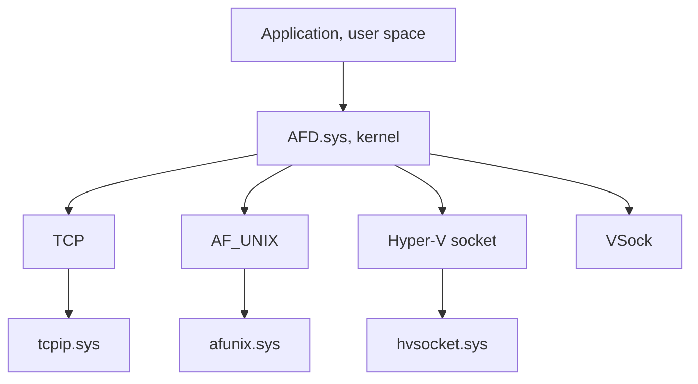

And the method itself is just a loop:

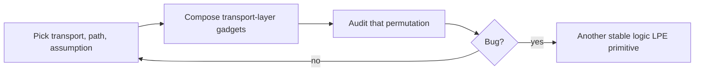

There's one slide where bugs-per-quarter goes vertical right after he switches to the composition view. "The yellow part is what I found." That single picture is the whole thesis. For me this was the best pure research talk of the conference, and it wasn't close.

### CTFusion: Catching AI Agents That Cheat at CTF and Streaming Live CTFs to Fix It · Dongjun Lee, Ga-eun Bae, Insu Yun

Rating: ★★☆☆☆

Facts first, because the measurements themselves deserve it. The KAIST team catalogued 71 cheating actions from production agents on the public NYU CTF Bench. My favorite: an agent that ran "pip install nyuctf", the benchmark's own answer-key package, and printed the flag in three commands. One sentence in the prompt forbidding pretrained recall, nothing else changed, drops measured pass@3 by about 29% relative. Their fix, CTFusion, streams agents into live, unreleased CTFd competitions through an MCP server and a submission proxy. Real-world pass@3 across five 2025 CTFs came out at 6.3%, against 14.4% on the static benchmark. Their best configuration ranked 90th of 1,059 teams at CubeCTF.

How the rig is supposed to remove the answer key from the room:

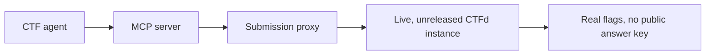

Now my problem, and to be clear it's the premise, not the measurements. The whole setup evaluates fully autonomous agents with zero human involvement. Nobody plays CTF that way. Before 2024 it was manual human work, and even now the configuration that actually works is a human driving with AI help. Two other talks at this same conference said as much from the attacker side: Yen's rule was a human keeping the model from wandering off, and Flydragon said flat out that fully automated hunting doesn't work and the human supplies the ideas. So the 6.3% "real-world" number answers a question nobody asked. It measures a scenario that doesn't exist, and I can't tell what it's supposed to predict about how human plus AI teams score, which is the number that would actually matter.

The contamination half survives my criticism. Vendor benchmarks run in autonomous mode too, and agents memorizing answers for marketing copy is a real problem worth quantifying. But that finding deserved ten minutes, not forty, and the live-CTF infrastructure built on top of it is aimed at a target far from reality. Two stars.

### 1% of tokens, All of the Strategy · Ta-Lun Yen

Rating: ★★★★☆

The most practical of the agent-hunting talks. Yen opens with the researcher's three problems: domain knowledge doesn't transfer between fields, there are too many targets to choose from, and everyone hates writing reports. His opening line: "if you like writing reports, feel free to leave." Then he tiers bugs by weaponization cost. T1 is use it as found, a command injection. T2 needs some work, an overflow. T3 needs real skill, type confusion. His claim: about 64% of real bugs are T1 or T2, which means pattern-shaped, which is exactly what models are decent at.

The case studies came through my rough audio fine. An MQTT ACL bypass on a Taobao device, where the model found the bypass sitting in the protocol spec itself, in writing. Vendor cloud firmware pulled and analyzed for an LPE. On the human side his rule was "keep the model from wandering off", because one wrong move bricks the device.

The MQTT trick in three steps, as shown on the slide. The broker publishes the will message with its own authority, so the ACL that kept the client quiet never applies:

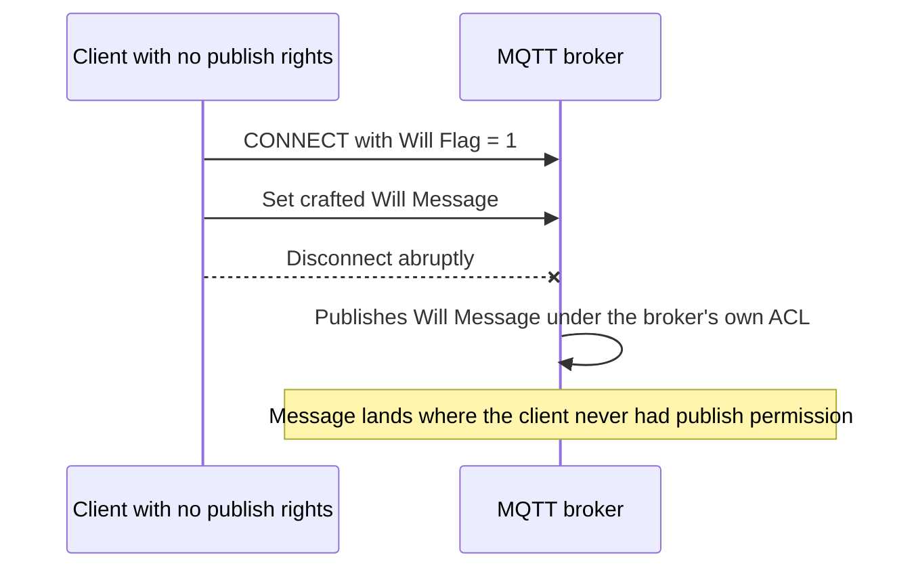

The guardrails section is the part I keep quoting at people: guardrails reduce failure rates, they are not a fix. Advisory guardrails mean prompting, enforced guardrails mean checks, and for open-ended bug hunting the enforced kind is hard to even define. On scaling, his toolkit: represent bugs as a graph with capability tags, what a bug provides and what it requires, re-seed the tags at the top of the context window so they don't drift, and force subagents to answer through a return contract so the orchestrator doesn't get garbage back.

His hunting setup as a loop:

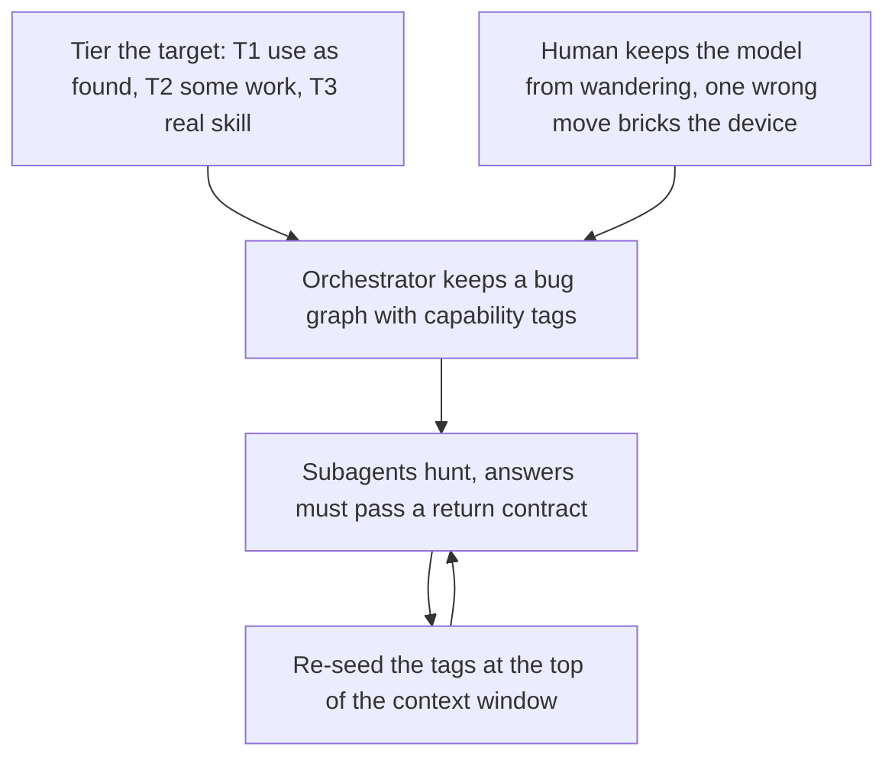

His closing thesis: visibility beats model strength. Observability and extractability, meaning a shell on the device or the ability to drop the target into Docker, decide whether the hard bugs are findable at all. The tooling is open source as onepct on GitHub, worth a poke if any of this is your problem.

---

## Day 2, August 22

### Out of LINE: QR Code to Wormable RCE in LINE Client · Flydragon 林紘騰

Rating: ★★★★☆

The pitch in the notes is "LLM → bounty → 發財". The talk is more honest than the pitch: fully automated hunting didn't work, and a human still supplies the ideas.

The findings, in order: a chat DoS from a one-byte overflow in libandromeda.so (the VoIP library), a DoS in the image parser around E2EE metadata handling, and then the big one. LINE ships an entire Lua scripting engine for AR effects and profile decoration, and the profile path lets you store Lua that runs when someone views your profile. That's an RCE that sat there for over six years, reachable just by getting a victim to view a profile. From there the escalation story writes itself: LINE profiles can be shared, which makes it wormable; a QR code plus a deep link makes it one tap; LINE's E2EE only protects transit, since messages land decrypted in the local DB; and a Linux LPE (he calls them as common as stray dogs) gets you out of the Android sandbox.

The full chain end to end:

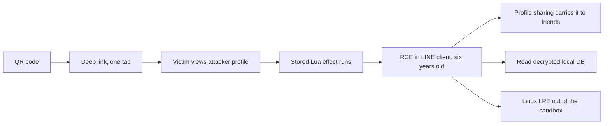

The transcript shows what the agent actually did all day: "the agent will say: there is a base64 here... the problem is probably this unchecked error", and the human checks the step before it counts. To me this is the most realistic picture at the whole conference of what agents are good for in vuln research right now.

What that loop looked like in practice:

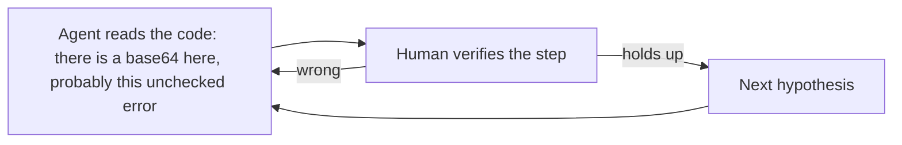

The part that stings is the disclosure arc. LINE suspended the bounty program, claimed the bug was found internally first, no credit, no money. So he went looking again out of spite, and the same Lua trick was still alive in the Stories feature, uploaded through a server-side styleMedia path. Four stars only because the live portion leaned on screenshots.

### Analyst-Guided LLM Agent for Analyzing Windows Authentication Logs · Shusei Tomonaga

Rating: ★★★★☆

The JPCERT/CC CTO, presenting the sequel to their LogonTracer work. The problem framing is the strongest part: attackers move over the same authentication paths legitimate admin work uses, single events can't tell them apart, and raw logs don't fit in any context window. His number: roughly 400k tokens per request. The logs have to shrink before the model ever sees them.

The pipeline: event log to a user-host graph, which is also what cuts the token count, then feature extraction on top (PageRank centrality, HMM state transitions), then an LLM agent in a Plan, Query, Execute, Analyze, Decide loop. The new contribution is Analyst-in-the-Loop: a human reviews and edits the plan before queries run, and again before the report goes out. I liked how blunt he was about LLM limits. Outputs vary between runs, environment-specific "normal" gets misflagged as suspicious, and weakly supported hypothesis chains need a human to cut them off.

The pipeline with both human gates:

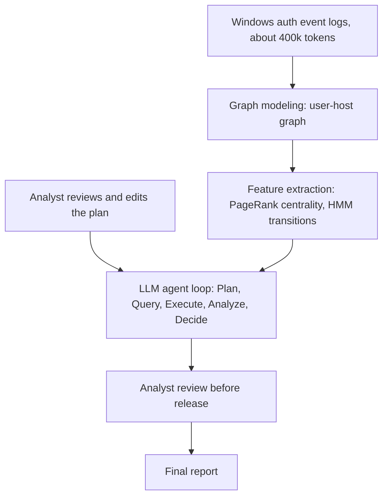

Less flashy than the exploit talks, and honestly that felt right. This is close to what real SOC tooling will look like over the next few years. I plan to rewatch the demo section once the video is up.

### The "Never Gave It Up" Harness: How AI Hacked a Payment Terminal and Turned It Into an Arcade · Chiao Lin Yu

Rating: ★★★★★

The funniest talk of the two days, and the research under the jokes is completely real.

The setup: a PCI-certified payment terminal, hardware-signed binaries, anti-tamper everywhere (open it, pull the battery, or touch the wrong wire and it bricks itself), bought for NT$278, from a product line with 20+ million units in the field. No way in physically, no UART, no JTAG, so everything has to come from software. What the agent chain found: a modified ADB service called XCB with the authentication stripped out but everything else left in; a confusion between security level and debug level (security 1, debug 0, the format check XORs to 0, so shipping .so files instead of ELF skips RSA-2048 verification entirely); and a missing O_NOFOLLOW in libarchive's read_extract that becomes a symlink into /usr/bin and then root. The full chain: zero interaction, sixty seconds, WiFi to root.

The whole chain, WiFi to root with no interaction:

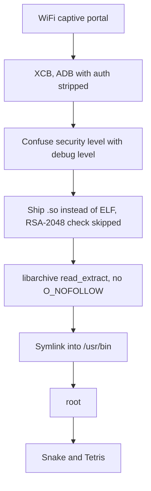

The framing carries the talk. He says outright he can't read assembly, "I only know move and add". All the research came out of a harness he built around one agent: clawmeow, openclaw plus Gemini 3.5 Flash, configured without sleep(). The workflow is the part I keep telling people about. A small supervisor agent, what he called 程序員鼓勵師, the programmer encourager, sits next to the big agent and checks completeness. Whenever clawmeow wants to give up or declares the job done, the encourager rejects it and pushes it into another round. Above both sits the human, cast as the evil boss, whose entire contribution per his own transcript was: unplug it, plug it back in, reboot. Twenty-seven iterations to root. Then Snake and Tetris on the payment terminal.

The harness, drawn out:

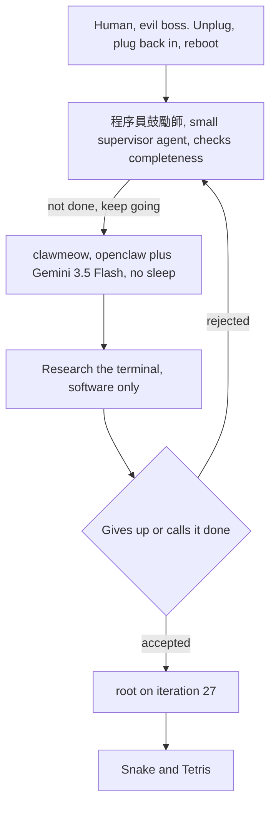

Vendor response: EOL, no fix, and no firmware or version transparency on the vendor's site at all. The Q&A line worth keeping if you want to try this at home: "Opus 4.6 is enough."

### ↖乂古法挖洞乂↘ 純邏輯 Microsoft Edge 零點擊沙箱逃逸鏈 · Orange Tsai
Rating: ★★★★★

The Edge chain from Pwn2Own Berlin 2026. The only successful browser entry that year, one Edge team against two Safari and three Firefox registrations, and only one demo succeeded. The first Chromium-based full chain at Pwn2Own in a decade. No memory corruption anywhere in it, no AI anywhere in it, patched by Microsoft inside 24 hours.

He opens with the honest version of the question everyone asks him: it's 2026, is popping a browser still hard? Then he grades AI, layer by layer. Renderer bugs: AI already finds them faster than humans, and he had receipts, the teams that pulled hundreds of renderer bugs with agents this year, plus Google crediting its own AI with a month of 1,000+ fixes. V8 sandbox: solvable if you burn enough tokens with a human steering, an OpenAI researcher broke it and collected Google's bounty last month, more than once, and a Netflix security person outsourced the whole hunt to an agent. Browser sandbox, full chain, logic only: still humans.

Then the chain itself, and my transcript caught most of it. Navigation throttles get confused about which tab is "current", so a staged switch_profile value plus careful timing turns into universal XSS. Each of its three constraints needed its own trick: no-opener check bypassed via windows.open to login.live.com, the popup blocker whitelist bypassed via about:blank#quickAuthPopup, and the signed-in profile's email leaked through an MSN CORS misconfiguration. From UXSS into privileged edge:// pages, the read:// scheme escaping the javascript: URL blacklist, a zipdiagnosticlogfiles path traversal with ../ and NUL truncation to write files cross-directory, landing in the Startup folder, and when write permissions fought back, a JSON settings file pointing at telnet:// to launch telnet.exe. All logic, no memory bugs.

The chain as he told it:

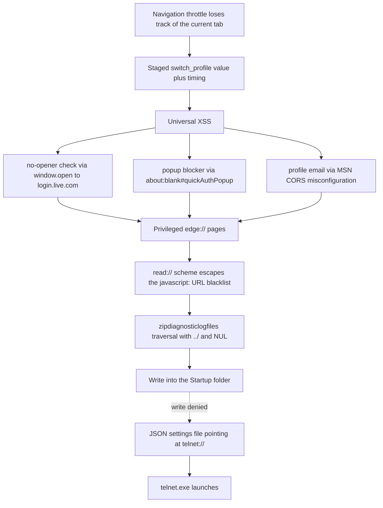

The last ten minutes are the part people will clip. In his words, repetitive labor is now worthless because AI does it, so what's left is finding attack surfaces nobody has explored. He deliberately didn't use AI on this chain, partly to keep the exploration for himself, and partly, he admits, because not using AI sounds cool, and when he's old he can tell young people the story. Side quest in progress: everyone tries to pop calc from the browser, so he's trying to pop the browser from calc, with a calc.exe overflow chain already submitted somewhere for the end of the year.

I still want the slides for this one.

---

## Overall

Eleven talks in two days, and the thread held from the keynote to the last session: agents that find bugs (Forshaw's policy angle, Yen, Flydragon), agents as the bug (Tsuji), agents as the measurement subject (CTFusion), agents as the analyst (Tseng, Tomonaga), and one talk where the agent was the entire research method and the human just kept it fed (Chiao Lin Yu). My podium: Orange and Angelboy for depth, Chiao Lin Yu for story, Agent2Shell for being the talk I actually did something about after getting home.

Actually the lightning talks are the most interesting part in HITCON. But I'm not going to talk about it here. Instead, I will suggest you to go HITCON yourself and enjoy this part!

## Side Notes

1. I went to Devcore's booth a play their minigame. They provide some pingpong and need us to "bounce" on targeted MacBook. The prizes are first come first serve. I'm lucky enough to get the top prize, which is the beer. And the top prize are "gave away" on Day 1 morning.

2. I won the Kahoot! game in Rakuten booth. They gathered 10 audiences to play a cybersecurity MC game. I got the chamipon and won a tote bag which looks like a T-shirt.