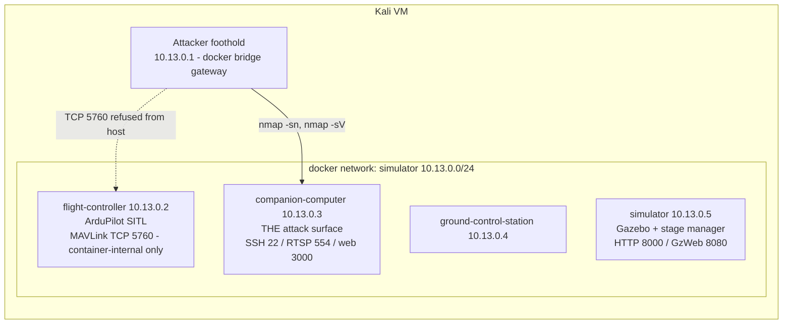
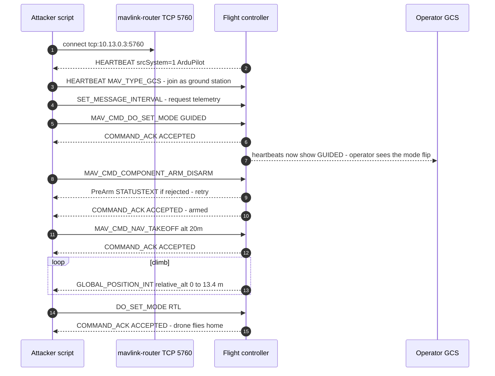
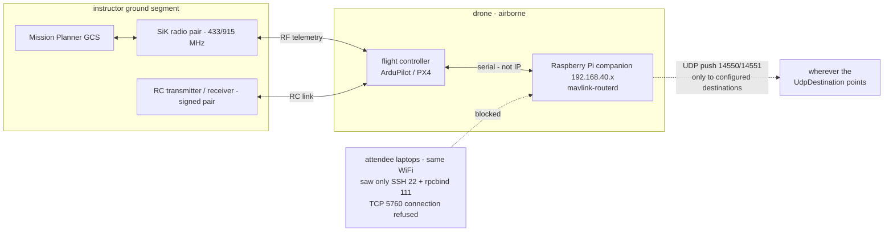
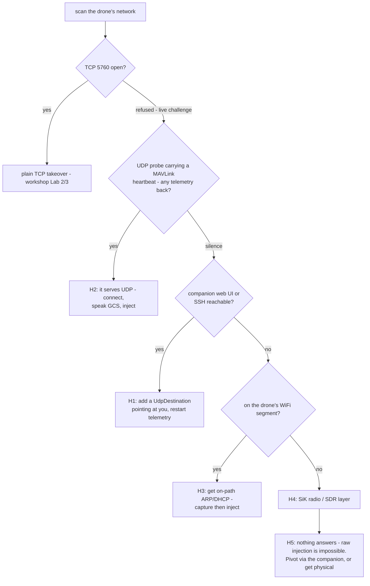

DC852 workshop, 11 October 2026, 2–5pm, City University of Hong Kong (P4704).
Agenda: OpenWRT intro → MAVLink drone telemetry hijack → live challenge to land a real drone.
This write-up combines my notes from the day, what's in the workshop VM, and a
follow-up experiment I ran afterwards on Windows.

---

## The opener: OpenWRT as a home security lab

The first session was Alan's, and it was less "intro to routers" than I
expected. The pitch: if you're doing security work at home (especially now that AI agents fire off network requests you didn't individually approve), you
want something watching the door, and a several-thousand-dollar firewall
appliance with a subscription is not the only answer.

His home build, roughly:

- Any router on the OpenWRT hardware compatibility list (check *before*
  buying: unsupported chipsets mean no SDK and no drivers), flashed with the
  official stable build rather than the snapshot branch.
- USB 3 stick for swap/external storage, because these boxes have 1 GB RAM
  and 8–16 MB flash and you *will* fill them.
- Firewall with zoning and port-based segmentation, plus Deep Packet
  Inspection so you can see what your own lab machines are doing.
- IDS/IPS (Suricata; he recompiles his own from source because the OpenWRT package lags), WireGuard VPN on the router so you never have to remember to
  turn the client VPN on, and dynamic routing so only AI/foreign traffic goes
  through the tunnel while local traffic stays fast.
- For the compute side: a Mini PC running ESXi, Intel over AMD if you can
  choose; some kernel-analysis instructions simply don't exist on AMD's
  instruction set, and P/E-core scheduling on newer Intel chips needs explicit
  VM pinning.

The part I keep thinking about is the framing: the router is there both to
protect the lab from the internet *and* to protect the internet from the lab —
he's had AI-driven tooling "hit the wrong target" concerns enough to put
monitoring at the router where he can see every flow leaving the house. A DIY
box worth a couple of thousand HKD ends up replacing what would otherwise be a
several-thousand-dollar UTM with an annual subscription.

## The simulator: Damn Vulnerable Drone

After the break we moved to the main event. Everyone got the same VirtualBox
image (~60 GB, Kali, everything pre-installed) with the Damn Vulnerable Drone
(DVD) stack: four containers.

| Container | Role |
|---|---|
| flight-controller | ArduPilot SITL (ArduCopter) |
| companion-computer | Raspberry-Pi-style companion: Flask web UI (:3000), mavlink-routerd, SSH, RTSP camera |
| ground-control-station | GCS container |
| simulator | Gazebo + a Flask "stage manager" (:8000) that drives the scenario |

The whole range in one picture: attacker foothold on the bridge gateway, and the only door into the drone is the companion computer:



The image comes from the Damn-Vulnerable-Drone project; the companion web UI
ships hard-coded credentials (`admin` / `cyberdrone`, visible in
`companion-computer/interface/app.py`), and the repo even includes
`passwords.txt` for the brute-force lab.

### Lab 1 — find the computer in the emulator

Recon from the host, which sits on the docker bridge gateway (10.13.0.1):

- `docker network ls` shows the dedicated `simulator` network, 10.13.0.0/24.
- `nmap -sn 10.13.0.0/24` finds five live hosts; `nmap -sV --top-ports 100`
  fingerprints each. Cross-checking against `docker inspect` container IPs is
  faster than pure fingerprinting — nmap tells you *what*, docker tells you
  *who*.

Result: the flight controller's MAVLink TCP 5760 is bound *inside* its
container and closed from the host. The attack surface is the **companion
computer** (10.13.0.3): SSH 22, RTSP 554 (live camera stream), Flask web app
on 3000.

### Lab 2 — MAVLink mode injection

Log into the companion web UI (default creds), then start telemetry with the
TCP server enabled: `POST /telemetry/start-telemetry` with
`enable_tcp_server: true, tcp_server_port: 5760`. That opens mavlink-routerd's
TCP endpoint on the companion, which bridges to the flight controller over a
socat PTY chain.

From there the takeover is honest work, not exploitation, because **MAVLink
has no authentication**. With pymavlink:

1. Connect to `tcp:10.13.0.3:5760`.
2. Wait for the flight controller heartbeat (filter `srcSystem == 1`; the same hub carries heartbeats from MAVROS and
   other clients, and locking onto the wrong one is a classic first-attempt
   failure).
3. Send a GCS heartbeat so ArduPilot treats you as a ground station.
4. Inject `MAV_CMD_DO_SET_MODE` → LAND/GUIDED/RTL, whatever you like.
5. Read the `COMMAND_ACK`: ACCEPTED.

`inject_mode_change.py` in the VM does exactly this, and the drone confirms
the new mode in its next heartbeat while the legitimate operator watches their
session lose control.

### Lab 3 — full flight takeover

`hijack_takeover.py` goes further and flies the drone end-to-end: GUIDED →
ARM → `MAV_CMD_NAV_TAKEOFF` to 20 m → watch `GLOBAL_POSITION_INT` climb →
RTL. That run completed during the workshop: ARM ACCEPTED, climbed 0→13.4 m
in 18 s, RTL accepted.

The full conversation, message by message:



A few operational lessons that cost the room some time (all now in
`workshop-notes.md` in the VM):

- An upside-down attitude (roll ≈ 177°) was the iris model was flipped in an old
  Gazebo world, and it presented as an arming failure. Check ATTITUDE before
  blaming your arming logic.
- Restarting the FC container silently breaks the companion link, because
  the FC's init.sh recreates the unix socket while the companion's socat
  keeps the old inode; mavlink-routerd then dies with a misleading
  "Invalid IP address /dev/ttyUSB0" (a missing pty falls into the UDP parse
  branch). Fix: restart the socat pty, then restart telemetry.
- `recv_match(type='COMMAND_ACK')` silently discards other message types, so
  PreArm rejection reasons never show up until you switch to unfiltered
  `recv_match()`.
- The simulator is stage-driven via the stage manager on 10.13.0.5:8000
  (`/stage1`, `/stage2`, `/reset`); restarting containers is not the same as
  re-triggering the stage.

### The forensics segment

The image also carries a DJI forensics track (`~/Desktop/Drone/uav_forensics`):
`dji-firmware-tools` to unwrap signed firmware (`dji_imah_fwsig.py`), brotli +
`sdat2img` to turn `system.new.dat.br` into a mountable `system.img`, then
Autopsy/`fls` and a read-only loop mount; the mounted image yields things
like `hostapd.conf` and `ftp.conf` straight from the flight controller's
Android system partition.

The DJI demo that stuck with me: the instructor has eMMC chip-off images from
a Mini 3 Pro and another model (a 54 GB artifact floating around the room),
and the interesting discovery was that the **FTP credentials inside are the
same across models**. Recover a crashed drone, pull `ftp.conf` from its
image, then connect over the USB/WiFi link to that FTP service and read the
flight logs (the "black box") directly, no vendor tooling needed. Newer log
versions (DAT v10+) are encrypted and need DJI's API key (free developer
account) to decode; he'd wrapped that in his own web tool and demoed it on
logs from a flight days earlier, flight path and all. He noted a 2026 CVE
landed in March covering this black-box exposure. On the physical layer,
option three: connect via USB (usb0), give yourself an IP on 192.168.40.0/24
and nmap the drone directly.

## The live challenge — where the simulator stops helping

The finale put a real drone on an isolated access point (its own SSID, no
internet, a Raspberry Pi companion inside). The setup on the instructor's side:
drone flying on Mission Planner over a SiK-style radio link, a dedicated RC
transmitter, the Pi at a 192.168.40.x address. The challenge, stated plainly: from *your own machine* on that network, change the drone's flight
mode. Set it to STABILIZE, he said; if you see it flip to RTL, you hit it.

Reality bit immediately. Port scans of the Pi showed 22 (SSH) and 111
(rpcbind) and that was basically it. `tcp:192.168.40.x:5760` (the exact endpoint that had worked all afternoon in
the simulator) came back **connection refused** on every laptop that tried. About twenty-seven people were probing
at once, several of them with AI agents writing the attack script (one model
flatly refused: it recognised "drone" and "damage" in the prompt; another
needed reframing as a security-research test). For a long stretch the room had
the whole DVD workshop in its head and zero footholds on the real thing.

The reveal, in the instructor's own words near the end: the answer is UDP, not
TCP: TCP needs a handshake, and there is no TCP listener. The drone's
MAVLink link rides **UDP on the standard ports (14550/14551, sometimes
5762)**, and the companion telemetry API everyone had used in Lab 2 has the
toggles for it right there: *enable TCP server* / *enable UDP 14550* and the
UdpDestination rows. Whether the drone *serves* UDP (connect in) or only
*pushes* to a configured GCS (become that destination) is a checkbox away.
Also worth knowing: the Pi-to-flight-controller hop is **serial**, not IP —
so once the UDP surface is pointed at you, the network is not in the path at
all, and the mode change lands. (Someone did get a mode change through late
in the session.) Two parting facts from the same discussion: the MAVLink
ports he chose were always the boring standards (14550/14551/5760/5762), so
port knowledge still counts; and consumer drones also broadcast **Remote ID**
(FCC-style "Zone ID"), which dedicated scanners pick up to find the aircraft
in the first place.

The links around the real drone, and why the attendee view looked so empty:



Which leaves the question this write-up really exists for: MAVLink over UDP —
what is it, and how do you send the packet when the port isn't visible?

## MAVLink over UDP: what it is and how an attack would actually work

**Is MAVLink UDP?** MAVLink is a wire *format* (binary frames), deliberately
transport-agnostic. In practice you meet it over: UART/serial telemetry radios
(SiK 433/915 MHz; "SiK" as in the SiLabs-style chip line, K for kilobit),
TCP 5760 (SITL, some companions), UDP 14550/14551 (the classic GCS ports),
UDP broadcast, WiFi bridges, and increasingly LTE. The DVD companion runs
mavlink-routerd, whose job is to be the meeting point: FC serial on one side,
TCP/UDP endpoints on the other. Its launch options (visible in
`companion-computer/interface/routes/telemetry.py`) are telling:
`-p 0.0.0.0:14550` opens a UDP *server*, and each `UdpDestination` row in the
web-UI database becomes `-e IP:PORT`, a UDP *push* target.

**Why "the port isn't visible" in real life:** with UDP there is no SYN to
scan for. A drone that only *pushes* datagrams to a configured GCS shows
nothing to nmap (UDP port scans are unreliable anyway: no response ≠ closed).
And if the link is UDP, a TCP connect to 5760 gets refused, which is exactly
what the live challenge looked like from the outside. So the realistic attack
shapes are:

- **H1 — Be the destination.** If you can read or set the drone's UDP
  destination, you win. On DVD that's the companion web UI's telemetry page
  (protected by `admin`/`cyberdrone` or a brute-forced password): add a
  UdpDestination pointing at your laptop, restart telemetry, and the drone
  now streams to you *and accepts your commands*. This is essentially the
  intended live-challenge path.
- **H2 — The drone runs a UDP server.** When the companion is configured with
  a UDP *server* (`-p 0.0.0.0:14550`), the port exists; it just answers nobody until spoken to. A plain SYN scan misses it; a UDP probe that sends
  a MAVLink heartbeat as payload will find it. Connect, send a GCS heartbeat,
  take over.
- **H3 — Sit on the packet path.** On the drone's WiFi segment (join the
  AP, whose historical defaults are legendary, or capture from monitor
  mode): ARP-spoof/DHCP-manipulate so the drone's datagrams traverse you,
  then inject downstream. UDP is stateless, so nobody renegotiates anything;
  the FC accepts whichever link last talked to it like a GCS. A 17-hour full UDP
  scan of the challenge subnet was floated as the brute-force version of
  this.
- **H4 — Radio layer.** If the drone uses a SiK-style telemetry radio, the
  "network" is the 433/915 MHz air interface: sniff with an SDR, sync to the
  MAVLink stream, transmit your own frames. Same format, different PHY; no
  authentication at any layer unless MAVLink v2 signing is enabled. In the
  live setup the legitimate GCS *was* on such a radio (Mission Planner), so
  the ground segment was a target too.
- **H5 — Pivot instead of inject.** When no MAVLink surface exists at all
  (only 22 and 111 answering), raw injection from outside is impossible, full
  stop. Pivot through the companion instead: the web UI (3000), SSH,
  MAVLink2Rest's HTTP API, or the RTSP camera, then inject *from* the
  companion, where the serial link to the FC always exists. (The
  instructor's one-liner during the challenge: the Pi and the FC are wired
  by serial, so anything you get running *on the Pi* doesn't care what the
  network looks like.)

The decision path, drawn once:



**How do you actually send the packets?** The takeover is ~40 lines of
pymavlink regardless of transport; the endpoint string is the only thing that
changes:

```python
mav = mavutil.mavlink_connection('udpin:0.0.0.0:14550')  # or 'udp:DRONE_IP:14550'
hb = mav.wait_heartbeat()                                # latch onto the FC
mav.mav.heartbeat_send(MAV_TYPE_GCS, MAV_AUTOPILOT_INVALID, 0, 0, 0)
mav.mav.set_mode_send(1, MAV_MODE_FLAG_CUSTOM_MODE_ENABLED, mode_id)  # GUIDED
master.arducopter_arm()                                  # MAV_CMD_COMPONENT_ARM_DISARM
mav.mav.command_long_send(..., MAV_CMD_NAV_TAKEOFF, ..., alt)
```

Note there is no handshake *at the MAVLink layer*. That is the point the
instructor kept returning to. TCP gives you a connection you can scan and
block; UDP gives you nothing to scan, and the protocol trusts whichever
socket talks to it in format. The only prerequisites are: hear one heartbeat
so you know the FC's system ID, speak GCS (system 255, heartbeat), then send
commands.

I verified this end-to-end on Windows: ArduPilot SITL (the same binary from
the workshop VM's flight-controller container) running in a local container,
pushing its stream over UDP through a 25-line stand-in for mavlink-routerd —
and from the host, `udp_takeover_windows.py` latched onto the heartbeat,
injected GUIDED, armed, took the drone to 15 m and sent it home with RTL,
receiving ACCEPTED at every step. Output is in
`D:\Drone\Drone\uav_udp_lab\demo_output.txt`.

The uncomfortable takeaway stands no matter which hypothesis you pick:
**the protocol trusts any speaker that knows the format.** Encryption and
authentication exist in MAVLink v2 (message signing) but are opt-in and
rarely enabled; the defenses that actually bite are keeping the MAVLink link
off untrusted networks, companion-computer hardening (the DVD web UI's
hard-coded credentials are the realistic entry point), geo-fencing/RTL
failsafes that survive a mode injection, and monitoring for duplicate GCS
heartbeats on the same link.

## Appendix

- The simulator is the open-source [Damn-Vulnerable-Drone](https://github.com/nicholasaleks/Damn-Vulnerable-Drone) project. Its wiki documents the attack scenarios, and everything in Labs 1-3 is reproducible with Docker Compose on Linux (or a Linux VM on Windows - which is how the workshop image was built).
- The workshop scripts (`hijack_takeover.py`, `inject_mode_change.py`, `injection_dvd.py`, `drone_stats.py`) live in the workshop VM under `~/Desktop/Drone/`, alongside `Damn-Vulnerable-Drone/workshop-notes.md`, the lab record quoted above.
- The MAVLink-over-UDP follow-up - an ArduPilot SITL "drone" container pushing its stream through a 25-line stand-in for mavlink-routerd, taken over from the Windows host with pymavlink - ran end-to-end and is what the takeover output in this post comes from.
- The two room recordings were transcribed with Whisper (medium model) as source material for this write-up.
